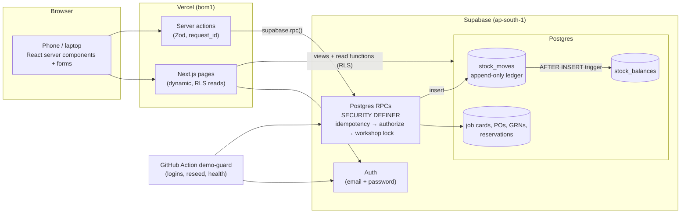

# Vutto Parts

Spare parts inventory for Vutto's two-wheeler refurbishment workshops (Delhi NCR and Jaipur).
Each bike's purchase inspection becomes its parts list before it reaches a repair bay, so parts are reserved or ordered early.
Purchase orders, goods receipt, putaway, reservations and issue to job cards all run on one stock ledger in Postgres.

**Live demo:** https://vutto-parts-blush.vercel.app (simulated data; the specification is [docs/SPEC.md](docs/SPEC.md))

## Demo logins

On the login page, tap a **Sign in as …** button. The password stays on the server. These accounts are shared, and a scheduled job restores their credentials every 2 hours.

| Role | Workshop | Email | What to try |
|---|---|---|---|
| Admin | All (switch with `?ws=`) | admin@demo.example.com | Planted scenarios (`/admin/planted`), Metrics with the Combined view, reset demo data, error log |
| Manager | Delhi NCR | ncr.manager@demo.example.com | Blocked board, a new bike with inspection findings, confirm a job card, generate and send draft POs |
| Store keeper | Delhi NCR | ncr.store@demo.example.com | On a phone: receive a PO, put away, issue to a bike, return a part, record an emergency buy |
| Manager | Jaipur | jpr.manager@demo.example.com | Same as NCR, on Jaipur data (Jaipur buys common parts from a Jaipur supplier) |
| Store keeper | Jaipur | jpr.store@demo.example.com | The store screens in Hindi (this login starts in Hindi) |

## Try this (2 minutes): one bike, one part, one PO

Demo chain A is a bike in repair that is blocked on exactly one part, and that part is covered by its own PO, due tomorrow. The codes come from `scripts/seed/planted.json` (`NCR.chains[0]`). Signed in as Admin, the same codes are listed at **Admin → Planted scenarios**, with links. **If chain A is already done** (the bike is no longer on the board, or the PO is received), use chain B or C. Each chain has its own bike and PO, so several reviewers can walk them without a reset.

1. **Manager** (NCR): open the **Blocked** board. Find chain A's bike (its reg no). It is waiting for one part, with an ETA of tomorrow from chain A's PO.
2. **Store keeper** (NCR, ideally a phone or a second browser window): **Receive** → chain A's PO → enter any invoice number and today's date → type received qty `1` → **Post GRN** → confirm. The result says the unit is reserved for chain A's bike.
3. **Manager**: reload the Blocked board. The bike is gone: its parts are complete.
4. **Store keeper**: **Put away** → the part → type or scan a bin code (e.g. `NCR-A01-01`) → put away.
5. **Store keeper**: **Issue** → search the last digits of the reg no → open the card → issue the part from that bin. The done screen shows what is left in the bin.
6. Optional: as **Manager**, open **Metrics** to see part-wait before and after pre-ordering (simulated), and **Stock** to see the ledger moves you just made.

## Architecture



## Key decisions

More detail is in [docs/DECISIONS.md](docs/DECISIONS.md).

- **Ledger + balances trigger.** Stock changes only by inserting a `stock_moves` row. A trigger keeps `stock_balances` in step, so every quantity can be traced and can never go negative.
- **RPCs with a workshop lock.** Every write is one Postgres function: it checks idempotency, authorises, then takes a per-workshop advisory lock. Two phones cannot sell the same last unit or lose an update.
- **Reservations with FIFO allocation.** Free stock goes to waiting bikes by needed-by date, then confirmation time. A reservation is never taken away silently; only a manager can reallocate one.
- **Inspection-driven demand.** Inspection findings become job card lines at purchase, so demand is known days before the bike reaches a bay.
- **No PO-to-bike links (pegging instead).** POs are per workshop and part. A view pegs open PO lines to waiting bikes by running totals, so the ETAs stay right when bikes are cancelled or priorities change.
- **IST time helpers.** Every "day" is an Asia/Kolkata day (`private.ist_date()`, `src/lib/time.ts`). The database stays in UTC, and the tests run in Los Angeles time to catch slips.
- **Paise integers.** Money is `bigint` paise end to end and is parsed from strings without floats.
- **Demo reset with date shift.** A deterministic 90-day simulation is stored once as a template and copied back with every date shifted to today. A reset takes under 3 s, and the data always looks current.

## Run locally

Prerequisites: Node 24, pnpm 10, Docker (running).

```sh
pnpm install
pnpm seed:gen              # writes supabase/seed/template.sql (before the first supabase start)
pnpm supabase start        # local Supabase on http://127.0.0.1:54321 (Studio on :54323)
cp .env.example .env       # then fill the keys from: pnpm supabase status -o env
pnpm demo:users            # creates the 5 demo logins (again after every supabase db reset)
pnpm dev                   # http://localhost:3000
```

## How the tests work

```sh
pnpm lint && pnpm typecheck
pnpm test        # unit (Vitest), run in TZ=America/Los_Angeles on purpose
pnpm test:db     # integration against local Supabase, acting as the real demo users
pnpm test:e2e    # Playwright on a Pixel 7 profile, against `next start` and local Supabase
```

- **Unit:** money parsing, IST time helpers, the reorder formula, bin-code parsing, error-code mapping, i18n key parity, and source guards (no secret key, metadata, caching, `parseFloat` or date-string parsing in `src/`).
- **DB integration:** each file clears the database (`private.test_clear()`) and builds its own fixtures, then calls the RPCs as the demo users over supabase-js, never as service_role. After every test, `private.check_invariants()` must return no rows. The suite also covers:
  - a security catalogue: RLS on every table, `security_invoker` views, grants, and an allowlist of public functions;
  - RLS isolation between workshops;
  - the SPEC §17 concurrency cases: the last unit issued twice at once, a concurrent double submit, and two draft-PO runs at once.
- **E2E:** chain C end to end (receive → bike leaves the board → put away → issue), the double-tap issue, receiving with damaged units, job card creation, metrics, logins, `/api/health`, and the phone rules at 360 px in English and Hindi.
- Tests refuse to run against anything but local Supabase (`assertLocal()`).
- [docs/edge-cases.md](docs/edge-cases.md) maps each SPEC edge case to its test.

## What's simulated

- About 90 days of operations per workshop: NCR ~32 and Jaipur ~6–7 bikes per working day, Monday to Saturday. This covers purchases, inspections, POs, GRNs, issues, returns and emergency buys. Rows are labelled "Simulated".
- The **before / after** story: for days −90 to −46, job cards are confirmed when the bike enters a bay; from day −45, they are confirmed at purchase. The metrics page compares the two periods.
- **Planted scenarios** (chains A–C, overdue and partly received POs, dead stock, a flagged fitment and more) are listed at `/admin/planted`.
- **Reset:** the data is reset to "today" by Admin → Reset demo data, and automatically when it is stale and nobody has used it for 24 hours.
- **demo-guard** (`.github/workflows/demo-guard.yml`):
  - every 2 hours, it checks each demo login and repairs only the broken ones;
  - every 6 hours, it also reseeds stale data and pings `/api/health`.
  - SPEC §16 asks for every 30 minutes. The repo stays private, so the interval is 2 hours to save Actions minutes, and the login page says so.

## What I'd build next

- Mechanic-facing pick lists and a counter queue, so parts are picked before the mechanic arrives.
- Supplier fill-rate and lead-time tracking from GRN history, fed back into reorder points.
- Stock transfers between workshops (out of scope today), with in-transit stock.
- Barcode labels on parts, not just bins, and scan-to-issue.
- A weekly trend chart for part-wait (deliberately left out of the phone bundle).

## Known gaps

- **Concurrency:** GRN racing a confirm on the same parts, concurrent emergency buys on one card, and two resets at once (or a reset racing an RPC) are not tested. The locks they rely on are in place.
- **Bill photos:** the `bills` bucket policies, `BILL_NOT_FOUND` and `attach_emergency_bill` have no tests.
- **Error boundary:** the "Demo database waking up" message is unit-tested (`classifyFailure`), but no test takes the database down end to end.
- **Local auth:** page reads verify the JWT with `getClaims()`. Locally (symmetric key) that is still one call to Auth; in production (asymmetric keys) it is a local check.
- [docs/edge-cases.md](docs/edge-cases.md) marks everything else as "not covered".

## Deploying

Pushing to `main` deploys. Vercel builds the app, and the Supabase GitHub integration applies new migrations to production. Never run `supabase db push`; see CLAUDE.md. `/api/health` returns `{ok, schema_version, commit}`, or a 503 with a clear message when the database is unreachable.
